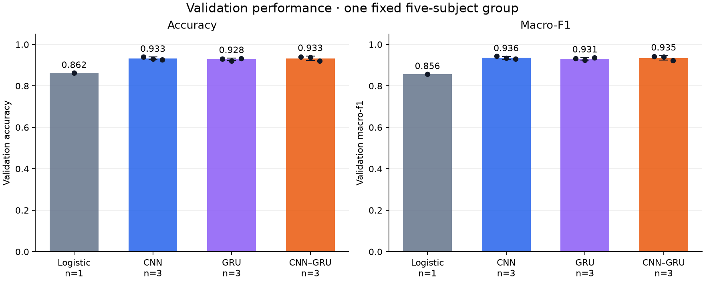
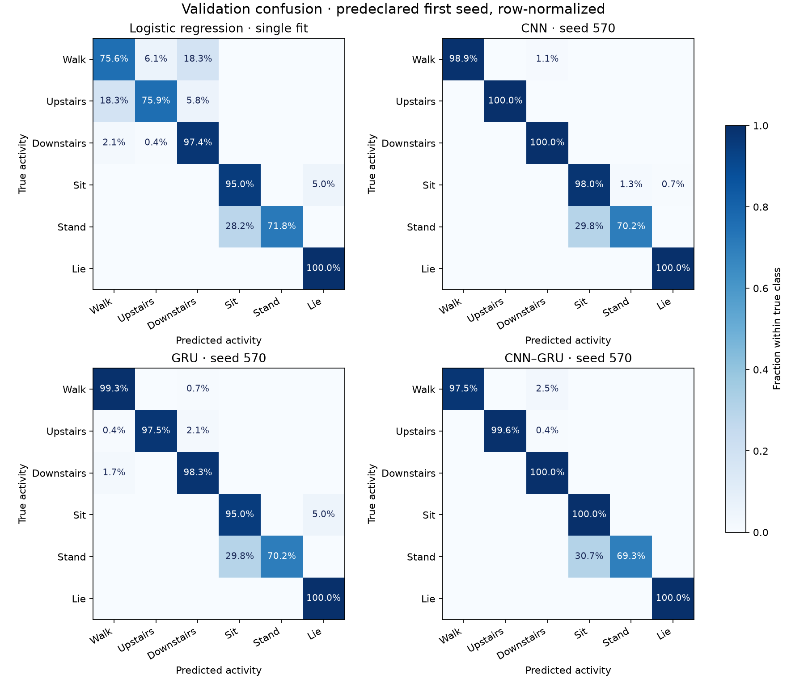
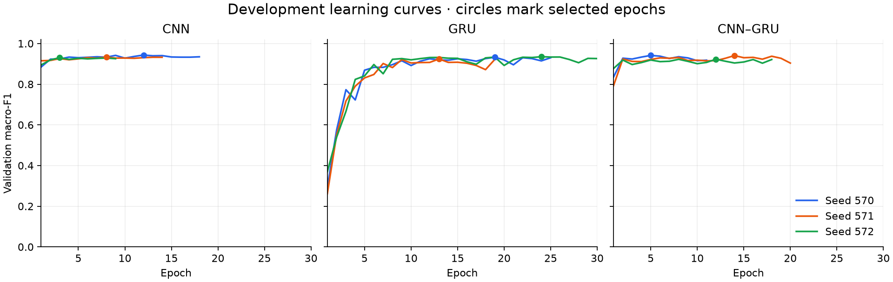

# Supervised development results

These are validation results on five fixed subjects, not final test or phone results.

The input split, preprocessing, architectures, training budget, and selection rules are
defined in [the protocol](../../supervised-module.md). Three seeds are reported for each
neural architecture; logistic regression is one deterministic fit. Dispersion is the
sample standard deviation across training seeds, not a confidence interval over people.

| Model | Runs | Validation accuracy | Validation macro-F1 | Parameters | Mean training (s) | Desktop median (ms) |
| --- | --- | --- | --- | --- | --- | --- |
| Logistic regression | 1 | 0.8619 | 0.8563 | 186 | 1.65 | 0.112 |
| CNN | 3 | 0.9329 ± 0.0067 | 0.9358 ± 0.0067 | 12,262 | 103.00 | 0.944 |
| GRU | 3 | 0.9276 ± 0.0059 | 0.9306 ± 0.0059 | 14,214 | 279.92 | 5.485 |
| CNN–GRU | 3 | 0.9327 ± 0.0107 | 0.9350 ± 0.0106 | 36,838 | 29.86 | 1.555 |

The highest mean validation macro-F1 belongs to **CNN**.
This is a development choice for the current split and budget, not evidence of
general superiority or statistical significance.

The mean macro-F1 difference from CNN–GRU is 0.0008.
Read this difference together with the seed dispersion in the table; the current
comparison does not establish a reliable advantage on new subjects.

Its two lowest mean class recalls are STANDING (0.693) and SITTING (0.968). The full per-seed matrices and class scores
are in [results.json](results.json).

Bars show means; points show individual runs; neural error bars show ±1 sample
standard deviation. The logistic baseline has one fit and no seed error bar.

These row-normalized matrices use the predeclared first seed (570), rather than
selecting a favorable seed for the figure. Each neural result has two additional
seeds in the machine-readable record.

Each curve is one run. Circles identify the highest-validation-macro-F1 epoch;
shorter curves reflect the shared early-stopping rule.

All selected checkpoints passed reload checks. Each neural architecture also passed
a saved-and-reloaded `.pt2` CPU export check on six training windows. Export seed
selection is recorded separately and is based on validation, not test scores.

Desktop times exclude sensor preprocessing and are not phone measurements.
Elapsed training times also reflect different stopping epochs and variable desktop
workload during the session. Treat them as run provenance, not a controlled
architecture-speed ranking.
The official test set remains unscored. No self-supervised, distillation, or
Android experiment is included. Checkpoints and full predictions stay in ignored
`ml/outputs/supervised-v1/`; rerun the notebook to recreate them.
